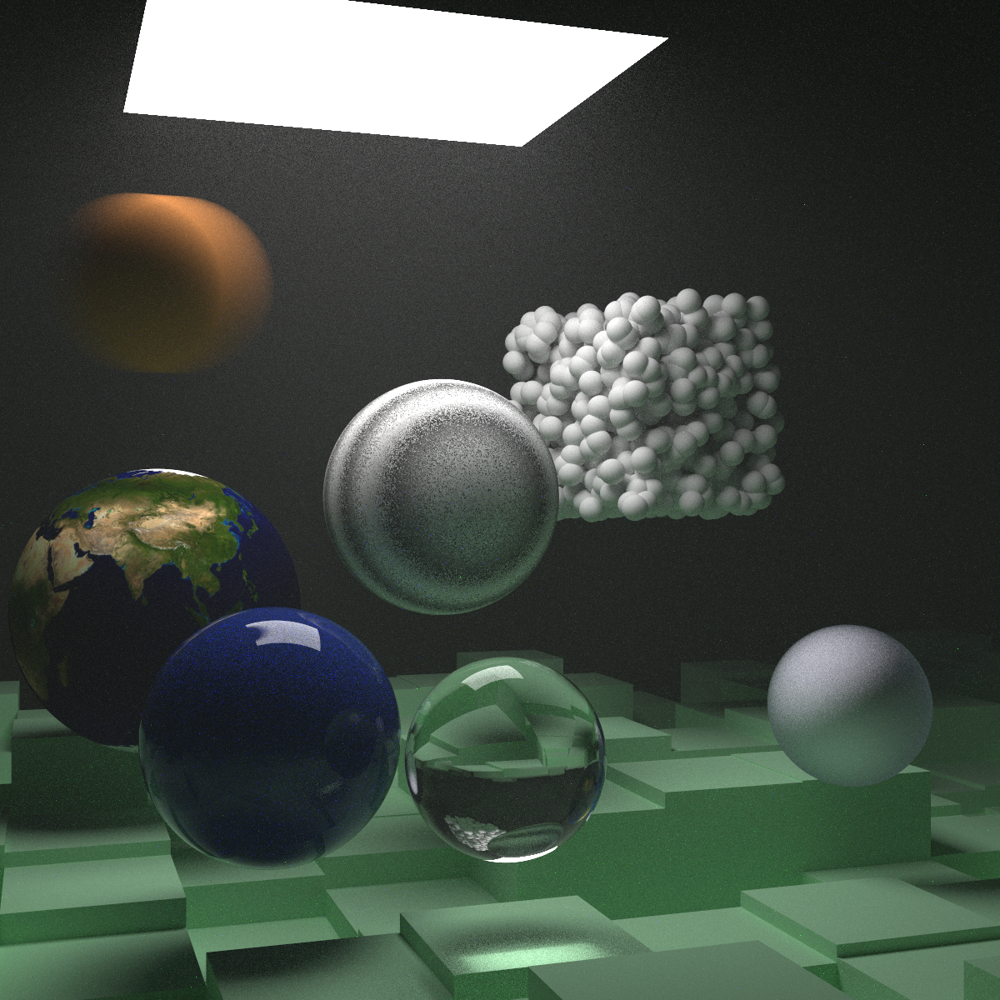
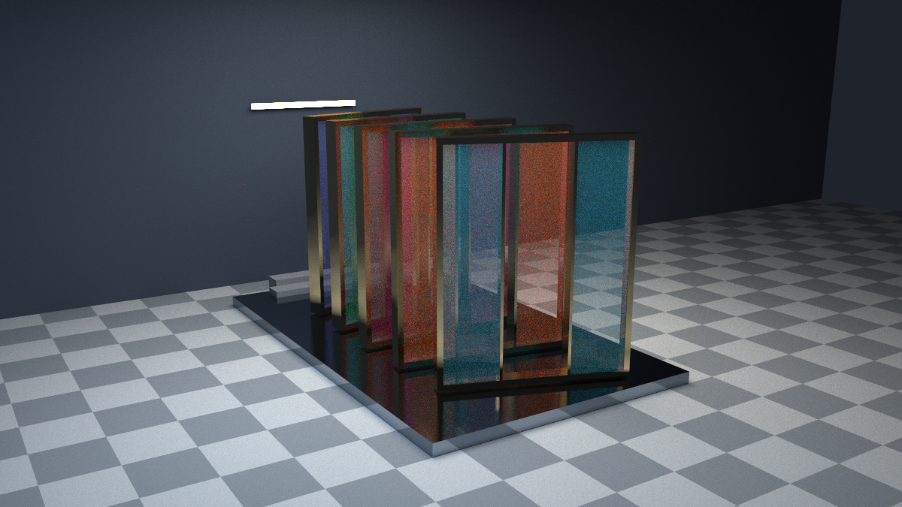

# RayTracer

C++로 구현한 CPU 기반 Ray Tracer입니다.

## 1. 프로젝트 소개

[Ray Tracing in One Weekend](https://raytracing.github.io/) 시리즈 3부작을 따라 구현하며, 광선과 물체의 교차 판정부터 재질에 따른 산란, BVH, Monte Carlo 적분과 Importance Sampling까지 학습했습니다.

교재를 바탕으로 구현한 BVH의 성능을 측정하고, 시리즈를 마친 뒤에는 렌더링 작업을 여러 스레드에 분배하는 기능을 추가했습니다. 객체 수와 Worker 수에 따른 렌더링 시간을 비교해 각각의 개선 효과를 확인했습니다.

- **사용 언어:** C++
- **개발 기간:** 2026.05.04 ~ 2026.10.28

## 2. 렌더링 결과

### Transparent — 추가 구성 장면

## 3. 주요 구현 기능

| 구분 | 구현 내용 |
| :--- | :--- |
| 기본 렌더링 | Ray 생성, 광선과 구·사각형의 교차 판정, 재귀적 산란, PPM 이미지 출력 |
| 카메라 | 시점 및 화각 설정, Anti-aliasing, Defocus Blur |
| 재질 | Lambertian, Metal, Dielectric, 발광 재질 |
| 텍스처 | Checker Texture, 이미지 Texture Mapping, Perlin Noise |
| 장면 구성 | 사각형을 조합한 Box, 이동·회전 Instance, Volume 산란 |
| 가속 구조 | AABB와 BVH를 이용한 교차 판정 최적화 |
| 샘플링 | Stratified Sampling, Cosine-weighted Sampling, 광원 방향 Sampling, Mixture PDF |
| 산란 처리 | PDF 인터페이스와 `scatter_record`를 이용한 재질별 산란 처리 |
| 병렬 처리 | Scanline 단위 작업 분배, 스레드별 난수 생성기, Framebuffer 기반 출력 |

## 4. 주요 구현 및 성능 분석

### 4.1. BVH를 이용한 교차 판정 최적화

모든 물체를 순회하며 교차 여부를 검사하는 방식은 객체 수가 늘어날수록 검사 비용이 커집니다. 이를 줄이기 위해 물체들을 AABB로 묶고, 계층적으로 탐색하는 BVH를 구현했습니다.

각 노드에서는 전체 경계 상자의 가장 긴 축을 선택하고, 해당 축의 경계 최솟값을 기준으로 물체를 정렬한 뒤 절반으로 나누어 하위 노드를 구성합니다. 광선이 노드의 AABB와 교차하지 않으면 그 아래 물체들의 교차 검사를 생략합니다.

작은 구의 개수를 늘려가며 BVH 적용 전후의 렌더링 시간을 각각 3회 측정했습니다.

Render settings:

- Aspect ratio: 16:9
- Image width: 400
- Samples per pixel: 10
- Max depth: 10
- Material: diffuse only

#### Before BVH

| Small Spheres | Total Objects | Run 1 | Run 2 | Run 3 | Avg |
| --: | --: | --: | --: | --: | --: |
| 100 | 101 | 17.175s | 14.576s | 14.366s | 15.372s |
| 200 | 201 | 26.454s | 26.543s | 26.740s | 26.579s |
| 500 | 501 | 62.637s | 60.111s | 60.007s | 60.918s |
| 1000 | 1001 | 117.167s | 117.447s | 118.706s | 117.773s |

#### After BVH

| Small Spheres | Total Objects | Run 1 | Run 2 | Run 3 | Avg |
| --: | --: | --: | --: | --: | --: |
| 100 | 101 | 6.242s | 5.238s | 5.478s | 5.653s |
| 200 | 201 | 6.272s | 6.146s | 6.286s | 6.235s |
| 500 | 501 | 9.228s | 9.085s | 9.224s | 9.179s |
| 1000 | 1001 | 11.589s | 11.242s | 11.269s | 11.367s |

#### Overall

| Small Spheres | Total Objects | Before BVH | With BVH | Speedup x |
| --: | --: | --: | --: | --: |
| 100 | 101 | 15.372s | 5.653s | 2.719x |
| 200 | 201 | 26.579s | 6.235s | 4.263x |
| 500 | 501 | 60.918s | 9.179s | 6.637x |
| 1000 | 1001 | 117.773s | 11.367s | 10.361x |

작은 구 100개에서는 약 **2.72배**, 1,000개에서는 약 **10.36배**의 속도 향상을 확인했습니다. 측정한 범위에서는 객체 수가 많을수록 BVH로 불필요한 교차 검사를 줄이는 효과가 커졌습니다.

### 4.2. 멀티스레딩을 통한 렌더링 병렬화

각 픽셀의 색상 계산은 다른 픽셀의 계산 결과에 의존하지 않으므로, 여러 Worker가 서로 다른 영역을 렌더링하도록 확장했습니다.

작업은 이미지의 한 행인 **Scanline 단위로 동적 배정**합니다. 장면에 따라 행별 계산량이 달라질 수 있으므로, 작업을 마친 Worker가 다음 행을 가져가도록 구성했습니다.

- `std::atomic`과 `fetch_add()`로 다음 행 번호를 가져와 동일한 행이 중복 배정되지 않도록 했습니다.
- 난수 생성기를 `thread_local`로 분리해 스레드 간에 난수 생성기 상태를 공유하지 않도록 했습니다.
- 행 번호를 기준으로 시드를 설정해 Worker 수나 작업 배정 순서가 달라져도 같은 행에서 동일한 난수열을 사용하도록 했습니다.
- 각 Worker는 담당 행의 계산 결과를 Framebuffer에 저장하고, 모든 Worker가 종료된 뒤 메인 스레드에서 PPM 파일을 출력하도록 계산과 출력을 분리했습니다.

Worker 수에 따른 렌더링 시간을 두 가지 설정에서 각각 3회 측정했습니다.

#### Benchmark 1

Render settings:

- Resolution: 300 × 300
- Samples per pixel: 50
- Max depth: 50
- Scene: Final Scene (The Next Week)
- Build: Release

| Workers | Run 1 (s) | Run 2 (s) | Run 3 (s) | Avg (s) | Speedup |
| ---: | ---: | ---: | ---: | ---: | ---: |
| 1 | 28.077300 | 27.956800 | 27.667800 | 27.900633 | 1.00x |
| 2 | 15.201500 | 15.379200 | 14.837300 | 15.139333 | 1.84x |
| 4 | 8.972880 | 8.769700 | 8.891170 | 8.877917 | 3.14x |
| 8 | 5.879360 | 5.924850 | 6.081560 | 5.961923 | 4.68x |

#### Benchmark 2

Render settings:

- Resolution: 800 × 800
- Samples per pixel: 100
- Max depth: 40
- Scene: Final Scene (The Next Week)
- Build: Release

| Workers | Run 1 (s) | Run 2 (s) | Run 3 (s) | Avg (s) | Speedup |
| ---: | ---: | ---: | ---: | ---: | ---: |
| 1 | 365.078000 | 363.961000 | 362.224000 | 363.754333 | 1.00x |
| 2 | 200.513000 | 203.993000 | 194.084000 | 199.530000 | 1.82x |
| 4 | 115.058000 | 113.497000 | 114.314000 | 114.289667 | 3.18x |
| 8 | 77.465800 | 78.209100 | 78.699100 | 78.124667 | 4.66x |

800 × 800 설정에서는 평균 렌더링 시간이 1 Worker 기준 **363.75초**에서 8 Workers 기준 **78.12초**로 줄어, 약 **4.66배**의 속도 향상을 확인했습니다. 두 설정 모두 Worker 수가 증가할수록 렌더링 시간이 감소했지만, Worker 수에 비례하는 선형적인 성능 향상에는 미치지 못했습니다.

## 5. 기술 정리

구현 과정에서 학습한 수학적 원리와 상세 코드, 실험 과정은 블로그에 정리했습니다.

| 주제 | 관련 글 |
| :--- | :--- |
| BVH 성능 측정 | [Benchmark Test](https://seoksoo.tistory.com/24) |
| Monte Carlo 적분 | [Monte Carlo Integration](https://seoksoo.tistory.com/32) |
| 광원 방향 샘플링 | [Sampling Lights Directly](https://seoksoo.tistory.com/36) |
| PDF 조합 | [Mixture Densities](https://seoksoo.tistory.com/37) |
| 산란 처리 구조 개선 | [Some Architectural Decisions & PDF Management](https://seoksoo.tistory.com/38) |
| 멀티스레딩 설계 | [Multithreading — Overview](https://seoksoo.tistory.com/40) |
| 멀티스레딩 구현 | [Multithreading — Implement](https://seoksoo.tistory.com/41) |
| 결과 검증 및 성능 측정 | [Multithreading — Verifying & Benchmark](https://seoksoo.tistory.com/42) |

## 6. Reference

- [Ray Tracing in One Weekend Series](https://raytracing.github.io/)